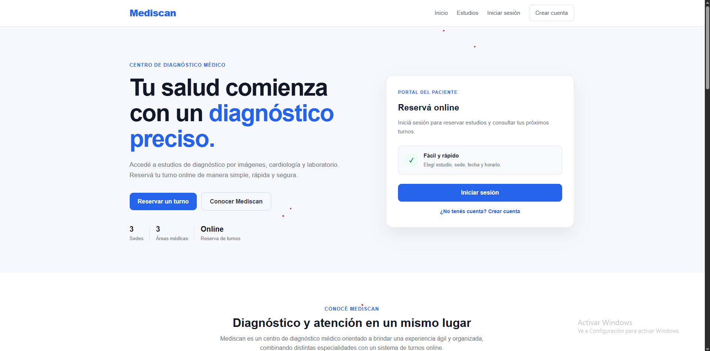
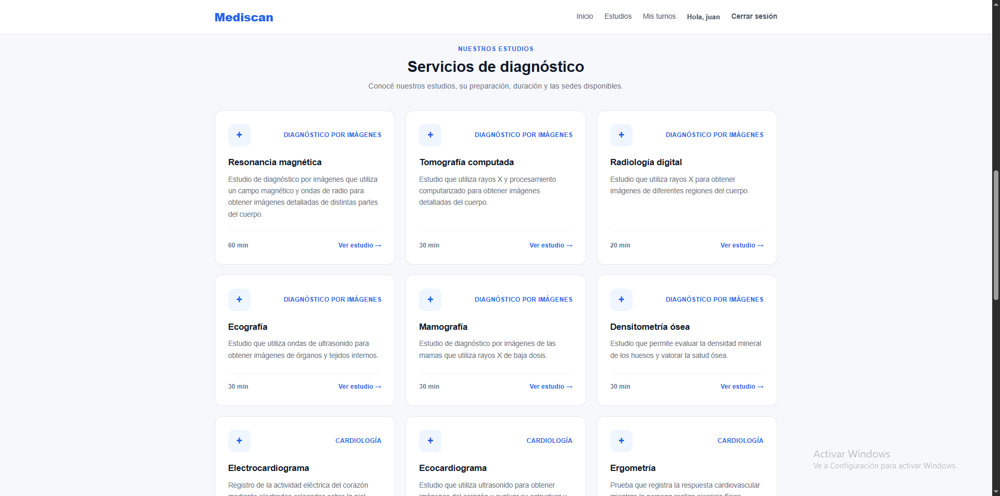
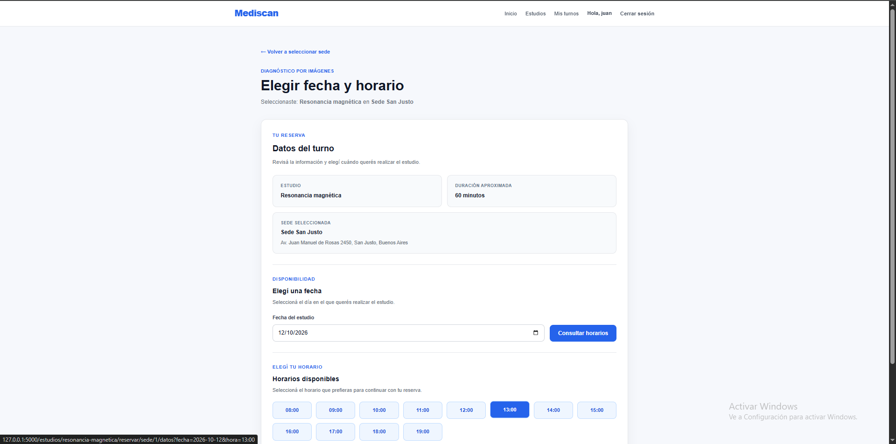
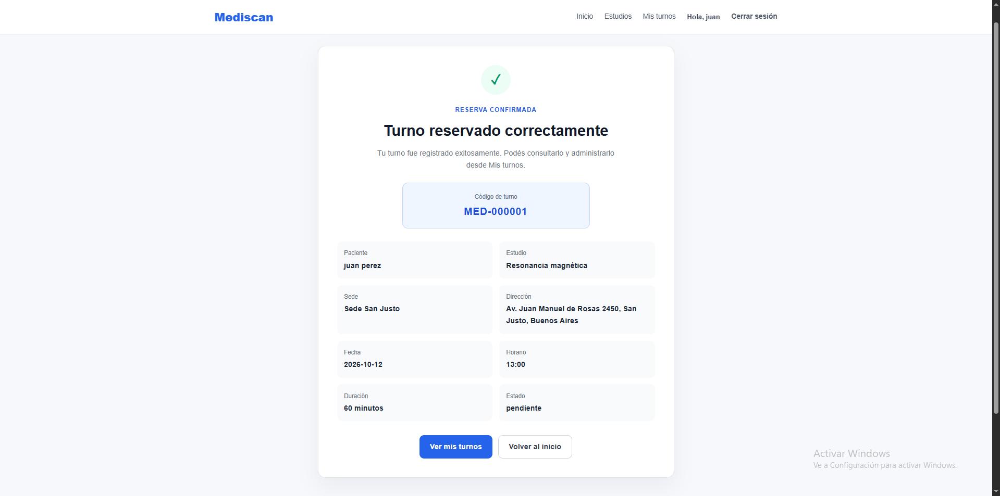
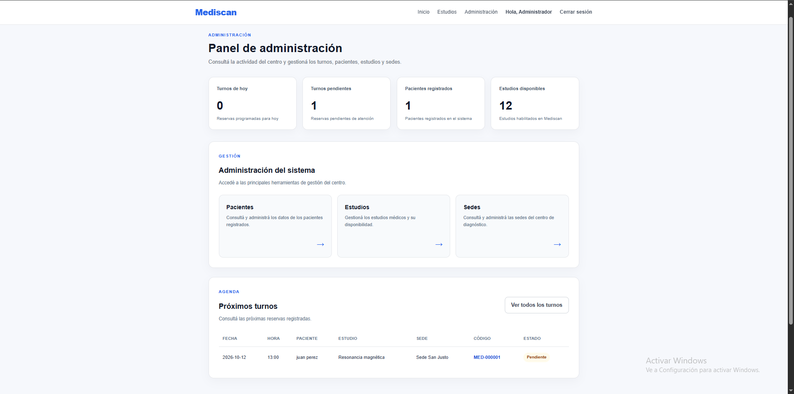

# Mediscan — Sistema de Gestión de Turnos Médicos

Mediscan es una aplicación web desarrollada con Python, Flask y SQLite para gestionar turnos en un centro de diagnóstico médico.

## Demo online

🌐 **Probá Mediscan:** https://mediscanarg.pythonanywhere.com

Aplicación web publicada en PythonAnywhere. Podés explorar los estudios, crear una cuenta de prueba y simular la reserva de turnos médicos.

**Importante:** Mediscan es un proyecto demostrativo. No ingreses datos personales reales.
  
El sistema permite a los pacientes consultar estudios, seleccionar una sede, reservar turnos y administrar sus reservas. También incluye un panel de administración para gestionar estudios, sedes, horarios y turnos.

## Aviso legal

Mediscan es un proyecto ficticio desarrollado con fines educativos y de portfolio profesional. No representa un centro médico real ni permite realizar reservas médicas reales. Las sedes y los datos de ejemplo son ficticios.
  
## Funcionalidades

### Pacientes
- Registro e inicio de sesión.
- Consulta de estudios médicos disponibles.
- Selección de sede, fecha y horario.
- Reserva de turnos con validación de disponibilidad.
- Consulta de turnos desde la cuenta personal.

### Administración
- Panel administrativo.
- Gestión de estudios médicos.
- Gestión de sedes.
- Configuración de horarios por estudio y sede.
- Consulta y administración de turnos.

## Tecnologías utilizadas

- **Python:** lógica del servidor.
- **Flask:** framework web.
- **SQLite:** base de datos.
- **HTML5:** estructura de las páginas.
- **CSS3:** diseño visual y responsive.
- **JavaScript:** interactividad.
- **Jinja2:** plantillas dinámicas.

## Estructura del proyecto

```text
sistema de turnos/
├── app.py
├── crear_base.py
├── crear_historial_turnos.py
├── verificar_base.py
├── requirements.txt
├── static/
│   └── css/
├── templates/
└── database/
```

## Capturas de pantalla

### Página principal


### Catálogo de estudios


### Reserva de turnos


### Confirmación de reserva


### Panel de administración


## Instalación local

### 1. Clonar el repositorio

```powershell
git clone https://github.com/davidjosem925-collab/mediscan.git
cd mediscan
```

### 2. Crear un entorno virtual

```powershell
python -m venv .venv
```

### 3. Activar el entorno virtual

En Windows PowerShell:

```powershell
.\.venv\Scripts\Activate.ps1
```

Si PowerShell bloquea la ejecución de scripts, se puede continuar utilizando directamente el ejecutable de Python del entorno virtual en los siguientes pasos, sin activarlo.

### 4. Instalar las dependencias

```powershell
.\.venv\Scripts\python.exe -m pip install -r requirements.txt
```

Verificar que Flask se haya instalado correctamente:

```powershell
.\.venv\Scripts\python.exe -m flask --version
```

### 5. Configurar las variables de entorno

Mediscan utiliza dos variables de entorno:

- `SECRET_KEY`: clave secreta utilizada por Flask para proteger las sesiones.
- `ADMIN_PASSWORD`: contraseña inicial del administrador, utilizada al crear la base de datos.

En Windows PowerShell:

```powershell
$env:SECRET_KEY = "REEMPLAZAR_POR_UNA_CLAVE_ALEATORIA_SEGURA"
$env:ADMIN_PASSWORD = "REEMPLAZAR_POR_UNA_CONTRASENA_SEGURA"
```

Para generar una clave secreta aleatoria, se puede ejecutar:

```powershell
python -c "import secrets; print(secrets.token_hex(32))"
```

Reemplazar el valor de `SECRET_KEY` por la clave generada y definir una contraseña segura para `ADMIN_PASSWORD`.

**Importante:** estas variables deben configurarse antes de crear la base de datos o iniciar la aplicación. Los comandos anteriores establecen las variables únicamente para la sesión actual de PowerShell.

No publicar contraseñas ni claves secretas en el repositorio.

### 6. Preparar la base de datos

```powershell
.\.venv\Scripts\python.exe crear_base.py
```

### 7. Iniciar la aplicación

```powershell
.\.venv\Scripts\python.exe app.py
```

Abrir la aplicación localmente:

http://127.0.0.1:5000

Demo pública disponible en:

https://mediscanarg.pythonanywhere.com

## Seguridad

- Las contraseñas de los usuarios se almacenan mediante hashes.
- Se utilizan sesiones para controlar el acceso.
- Las funciones administrativas requieren permisos de administrador.
- La clave secreta se configura mediante una variable de entorno.
- La base de datos local y los archivos privados están excluidos del repositorio mediante `.gitignore`.

## Estado del proyecto

Proyecto de portfolio desarrollado con fines educativos y demostrativos.

## Autor

**David Martin**

Desarrollador web y programador.

Este proyecto forma parte de mi portfolio profesional.
